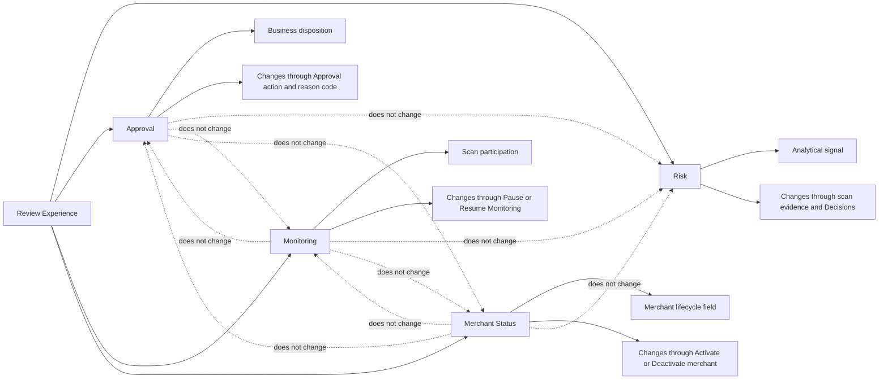
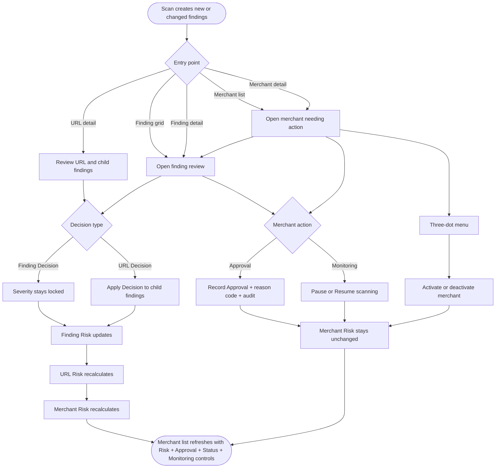

# PRD: Risk and Actioning for Findings, URLs, Merchants

## Document Metadata

| Field        | Value |
| ------------ | ----- |
| Feature      | Risk and Actioning for Findings, URLs, Merchants |
| Product Area | Unified Platform / Merchant Monitoring / Risk and Compliance Workflow |
| Release      | MVP |
| Owner        | TBD |
| Status       | Draft |
| Date         | 2026-06-29 |

---

## Executive Summary

Unified Platform needs a clear, durable separation between what the scan says and what the human decided, and at the merchant level between how risky a merchant is, what business decision was recorded, whether monitoring is paused or resumed, and whether the merchant itself is Active or Inactive. Legacy behavior mixes scan output, review outcomes, monitoring controls, merchant lifecycle state, and workflow states, so users cannot tell whether a merchant is risky because of scan evidence, because a reviewer already dispositioned it, because monitoring was paused, or because the merchant was deactivated.

The MVP introduces a separated model across Finding, URL, and Merchant: **Risk** is analytical and rolls up from scan-set Severity plus review Decisions; **Approval** is the business disposition; **Monitoring** is controlled through pause/resume actions; and **Merchant Status** records whether the merchant is `Active` or `Inactive`. A business decision never rewrites merchant Risk. An Approved merchant keeps whatever Risk the scan and review rollup produced, and merchant result surfaces show Risk, Approval, Merchant Status, and Monitoring controls as distinct concepts.

This scope is the right first step because it covers the customer workflows that already have strong legacy usage: finding triage, status/actioning, pause/resume monitoring, merchant-list prioritization, merchant activation controls, and MMP reporting evidence. It also avoids destructive Deboard semantics in MVP while keeping a reversible `Rejected` disposition, independent pause/resume monitoring control, and reversible `Active` / `Inactive` merchant status.

The outcome is a post-scan review workflow where analysts can enter from a merchant, URL, or finding surface, understand how each finding Decision affects finding Risk and rolls up to URL and merchant Risk, record merchant Approval in the same review context where appropriate, and give compliance stakeholders structured Approval and audit evidence.

---

## Problem Statement

| Area             | Description |
| ---------------- | ----------- |
| Current gap      | UP does not separate scan-set `Severity` from review-adjusted `Risk`; it lacks merchant-level `Approval`; it conflates business disposition with monitoring pause/resume controls; and it does not clearly expose merchant `Active` / `Inactive` status as a separate field. |
| User pain points | Analysts enter review after scans through finding, URL, merchant, and list surfaces, but cannot see a single coherent path from finding Decision to finding Risk, URL Risk, merchant Risk, merchant Approval, merchant Status, and monitoring controls. They also re-review decided findings, cannot tell whether merchants still need business action, and cannot trust that new findings will reopen previously Approved or Rejected merchants. |
| Business impact  | MMP reporting, compliance evidence, and analyst workload management require structured merchant disposition instead of manual reconciliation. |
| Risk if unsolved | Customers may miss new risk, over-review already decided work, misread Risk as workflow state, or continue relying on legacy tooling during UP migration. |
| Evidence         | Legacy Mixpanel shows broad use of finding triage, finding metadata, status actioning, and pause/resume workflows across customer accounts. |

---

## Goals

* Separate scan-set `Severity` from review-adjusted `Risk`.
* Let customer-facing users influence Risk only through finding and URL `Decision`, never by editing `Severity` or `Risk` directly.
* Recalculate URL Risk from finding Risk and merchant Risk from URL Risk in real time.
* Provide merchant-level `Approval` values of `To Review`, `In Progress`, `Approved`, and `Rejected`, independent of Risk, Monitoring, and Merchant Status.
* Let users set merchant Approval from merchant context and from finding review context when the merchant relationship is visible.
* Provide merchant Monitoring as independent `Pause Monitoring` and `Resume Monitoring` actions, not as the merchant's active/inactive status.
* Provide merchant `Status` values of `Active` and `Inactive`, shown on each merchant result and controlled from the three-dot menu in the top-right corner of the merchant result screen.
* Let users deactivate an Active merchant through `Deactivate merchant` and reactivate an Inactive merchant through `Activate merchant` from the same three-dot menu location.
* Persist finding Decisions across scans so already decided findings do not re-surface unless the scan changes or removes them.
* Reopen Approved or Rejected merchants to `In Progress` when new or changed findings appear.
* Add merchant-list and merchant-result Risk, Approval, Merchant Status, Monitoring controls, default prioritization, and a `Need Action` filter.
* Capture reason codes and backend audit records for Decision, Approval, Merchant Status, and Monitoring changes.

---

## Assumptions

* `Severity` is authored by G2 scanning and is never editable in UP by any customer-facing role.
* Risk levels are ordered for sorting, but the exact ordering is still an open Product / Design decision.
* MVP represents reversible merchant lifecycle control through `Active` / `Inactive`; destructive Deboard is deferred.
* Approval changes require a controlled reason-code vocabulary before launch.
* Backend audit exists in MVP, but customer-facing audit UI is out of scope.

---

## Target Personas

| Persona   | Description |
| --------- | ----------- |
| Risk Analyst | Day-to-day customer user who reviews findings, URLs, and merchants and needs a clear queue of work that still needs action. |
| Risk Manager | Customer portfolio owner who oversees merchant risk, records business disposition, manages monitoring pause/resume controls, and can activate or deactivate merchants. |
| Platform Admin | Internal or customer admin with full actioning capability plus configuration responsibility. |
| Compliance Reporting Stakeholder | Read-only customer stakeholder who consumes structured Approval and audit evidence for MMP reporting. |
| Product Analyst | Internal analyst who validates adoption, actioning throughput, recalculation integrity, and reporting quality. |

---

## Scope

### In Scope - MVP

#### Core Principle: Separate Concepts

MVP includes four separate concepts: Risk, Approval, Monitoring, and Merchant Status. Each concept has its own meaning, user behavior, and system effect. One action must not silently change another concept.



#### Risk Model

Risk is the analytical model for scan and review evidence.

* Finding-level `Severity` is scan-set and not editable.
* Finding `Decision` values are `To Review`, `In Progress`, `Risk`, and `No Risk`, with `To Review` as the default value.
* Finding `Risk` is derived from `Severity` and adjusted only through finding `Decision`.
* URL-level `Decision` uses the same values as finding `Decision`.
* URL-level `Decision` applies the selected value to all findings under the URL.
* URL Risk recalculates from finding Risk.
* Merchant Risk recalculates from URL Risk.
* Users cannot edit Risk directly.
* Approval, Monitoring, and Merchant Status do not change Risk.
* `No Risk` removes the finding from URL and merchant Risk contribution.
* `Risk` keeps the finding contributing according to its Severity-derived Risk.
* `In Progress` leaves the finding pending while still contributing until resolved.

#### Merchant Approval

Approval is the business disposition for the merchant. It is separate from analytical Risk, scan participation, and merchant lifecycle status.

* Merchant `Approval` values are `To Review`, `In Progress`, `Approved`, and `Rejected`, with `To Review` as the default value.
* `To Review` means never actioned.
* `To Review` and `In Progress` mean Need Action.
* Approval requires a controlled reason code when changed.
* Approval does not change Risk.
* Approval does not pause monitoring.
* Approval does not change Merchant Status.
* `Rejected` means the business does not approve the merchant at this point.
* `Rejected` does not pause monitoring, deactivate the merchant, or change Merchant Status.
* New or changed findings reset `Approved` and `Rejected` merchants to `In Progress` unless monitoring is paused.
* Merchant Approval controls are available in merchant detail and in post-scan finding review context when the parent merchant is visible.

#### Monitoring Control

Monitoring controls scan participation only.

* Monitoring is controlled by `Pause Monitoring` and `Resume Monitoring` actions.
* `Pause Monitoring` means the merchant is not scanned in future scan cycles.
* `Resume Monitoring` means the merchant is included again in future scan cycles.
* Pause / Resume does not change Risk.
* Pause / Resume does not change Approval.
* Pause / Resume does not change Merchant Status.
* Paused merchants are not reopened by scan changes because they are not scanned until resumed.

#### Merchant Status

Merchant Status is the merchant lifecycle field. It is separate from Approval and does not imply any risk decision.

* Merchant `Status` values are `Active` and `Inactive`.
* Merchant Status is shown on merchant result surfaces.
* `Deactivate merchant` is available from the top-right three-dot menu when Merchant Status is `Active`.
* `Activate merchant` is available from the same menu when Merchant Status is `Inactive`.
* Activate / Deactivate changes only Merchant Status.
* Merchant Status does not change Risk.
* Merchant Status does not change Approval.
* Merchant Status does not pause or resume Monitoring unless explicitly defined later.

#### Merchant List and Review Surfaces

Review surfaces show the four concepts together while keeping labels and actions separate.

* Merchant list shows Risk, Approval, Merchant Status, and Monitoring controls.
* Merchant result shows Risk, Approval, Merchant Status, and Monitoring controls separately.
* Finding review context shows parent URL Risk, merchant Risk, merchant Approval, Merchant Status, and Monitoring controls where relevant.
* `Need Action` filter includes `To Review` and `In Progress` Approval.
* `Need Action` excludes `Approved` and `Rejected` Approval.
* Default merchant-list sort is Approval status, then Risk.
* `Need Action` treats Monitoring and Merchant Status as orthogonal.

#### Scan Cycle and Persistence Behavior

Scan-cycle behavior cuts across Risk, Approval, and Monitoring, so it is defined explicitly.

* Decided findings persist across scans.
* Previously decided findings are not re-surfaced unless changed or removed by scan output.
* New or changed findings reset `Approved` and `Rejected` merchants to `In Progress` unless monitoring is paused.
* Merchant Risk recalculates based on current finding and URL Risk.
* Paused merchants are not scanned until resumed.
* Rejected merchants are still scanned unless monitoring is paused.

#### Audit, Permissions, and Governance

Governance behavior applies across all mutation types.

* Backend audit history is required for Decision, Approval, Monitoring, and Merchant Status changes.
* Audit includes actor, timestamp, previous value, new value, and reason code when relevant.
* Server-side authorization is required for all Decision, Approval, Monitoring, and Merchant Status mutations.
* Reason codes are required for Approval changes.
* Customer-facing audit UI is out of scope.

### Out of Scope

* Finding or URL `Decision` value `Dispute`.
* Finding `Decision` values `Escalate` and `False Positive`.
* Destructive Deboard or hard offboarding end-state with downstream signals.
* Bulk merchant actioning.
* Free-form reason codes.
* Customer-facing audit trail UI.
* Automatic Approval calculation from findings.
* Direct user editing of `Severity` or `Risk`.
* Changes to the G2 scanning process that sets `Severity`.
* Organization-level risk matrix configuration.
* Historical migration of legacy adjusted-risk or status terminology.
* Automatic Approval changes when Merchant Status changes.

---

## User Journeys

### Primary Journey

1. A scan completes and creates new or changed finding evidence for one or more merchants.
2. User enters the review workflow from one of the supported entry points: merchant list, finding grid, finding detail, URL detail, or merchant detail.
3. In the finding review context, the system displays finding `Severity`, finding `Risk`, finding `Decision`, parent URL Risk and Decision, merchant Risk, merchant Approval, Merchant Status, and merchant Monitoring controls where relevant.
4. User changes a finding `Decision`; or, from URL context, changes a URL `Decision` that cascades to all findings under the URL.
5. System recalculates finding Risk, URL Risk, and merchant Risk in real time while leaving scan-set Severity unchanged.
6. From the same review context where the parent merchant is visible, user can set merchant Approval to `In Progress`, `Approved`, or `Rejected` with a required reason code, or pause/resume Monitoring.
7. From the merchant result screen, user can open the top-right three-dot menu and select `Deactivate merchant` when the merchant is Active or `Activate merchant` when the merchant is Inactive.
8. System records audit history, leaves merchant Risk unchanged by Approval, Monitoring, or Merchant Status, and updates merchant result surfaces.
9. User can return to the merchant list, where Risk, Approval, Merchant Status, Monitoring controls, default sort, and `Need Action` filtering reflect the latest state.
10. On the next scan, decided findings stay closed; new or changed findings reopen Approved or Rejected merchants to `In Progress` unless monitoring is paused.



---

## Acceptance Criteria

### Scenario 1: Post-scan finding review supports merchant Approval in context

**As a** Risk Analyst
**I want to** enter review from a post-scan finding surface
**So that** I can decide finding Risk impact and record the merchant's business disposition in one workflow

```gherkin
Given a scan has created new or changed findings for a merchant
And the user opens the finding from the finding grid, finding detail, URL detail, merchant detail, or merchant list
When the user changes the finding Decision
Then finding Risk updates according to that Decision
And parent URL Risk and merchant Risk recalculate in real time
And the same review context shows merchant Approval and Merchant Status when the parent merchant is visible
And the user can set merchant Approval with a required reason code without changing merchant Risk
```

### Scenario 2: Finding decision adjusts Risk, never Severity

**As a** Risk Analyst
**I want to** change a finding's Decision
**So that** Risk reflects review while Severity stays scan-set

```gherkin
Given a finding has Severity set by G2 scanning
And finding Risk initially matches the Severity-derived risk
When the user changes the finding Decision to No Risk
Then finding Risk becomes No Risk
And Severity remains unchanged
And URL Risk and merchant Risk recalculate without that finding contributing risk
```

### Scenario 3: URL decision cascades to all findings below

**As a** Risk Manager
**I want to** action at the URL level
**So that** all findings under that URL inherit the same decision

```gherkin
Given a URL has multiple findings contributing to URL Risk
When the user sets the URL Decision to No Risk
Then every finding under that URL is set to No Risk
And URL Risk becomes No Risk
And merchant Risk recalculates from URL Risk
```

### Scenario 4: Merchant Approval does not change merchant Risk

**As a** Platform Admin
**I want to** record a business decision on a merchant
**So that** disposition is captured without distorting analytical risk

```gherkin
Given merchant Risk is High
When the user sets Approval to Approved with a reason code
Then Approval becomes Approved
And merchant Risk remains High
And the merchant list shows Approval and Risk as separate values
```

### Scenario 5: Prioritize merchants needing action

**As a** Risk Analyst
**I want to** sort and filter the merchant list
**So that** I can prioritize what still needs action

```gherkin
Given the merchant list shows Risk, Approval status, Merchant Status, and Monitoring controls
When the list loads by default
Then merchants are sorted by Approval status and then by Risk
And enabling Need Action excludes Approved and Rejected merchants
And To Review and In Progress merchants remain visible regardless of Monitoring or Merchant Status
```

### Scenario 6: New scan reopens decided merchants but not decided findings

**As a** Risk Manager
**I want to** re-review merchants when new evidence appears
**So that** prior decisions do not hide new risk and resolved findings are not repeated

```gherkin
Given a merchant has Approval Approved or Rejected
And some findings were previously decided as Risk or No Risk
When a new scan finds new or changed findings or violations
Then previously decided findings are not re-surfaced
And merchant Approval changes to In Progress
And merchant Risk recalculates from finding and URL Risk
```

### Scenario 7: Reject does not pause monitoring or deactivate merchant

**As a** Risk Manager
**I want to** rejected merchants to stay eligible for monitoring unless I explicitly pause monitoring or deactivate the merchant
**So that** the client can re-approve them if future scan evidence changes

```gherkin
Given a merchant has Approval Rejected
And monitoring has not been paused
And Merchant Status is Active
When the next scan runs and finds new findings
Then monitoring remains unpaused
And Merchant Status remains Active
And merchant Approval changes to In Progress for re-review
```

### Scenario 8: Pause / Resume monitoring is sticky and independent of Approval and Merchant Status

**As a** Risk Analyst
**I want to** pause monitoring without it resetting on its own
**So that** I control when scanning resumes

```gherkin
Given the user has selected Pause Monitoring for a merchant
When scan cycles run for the portfolio
Then the paused merchant is not scanned
And its Approval status is unchanged by scanning
And Merchant Status is unchanged by pausing monitoring
And monitoring only resumes when a user selects Resume Monitoring
```

### Scenario 9: Merchant Status can be deactivated and reactivated from the merchant result menu

**As a** Risk Manager
**I want to** deactivate or activate a merchant from the merchant result screen
**So that** merchant lifecycle status is visible and controlled separately from Approval and Monitoring

```gherkin
Given the user opens a merchant result screen
And Merchant Status is Active
When the user opens the three-dot menu in the top-right corner
Then the menu shows Deactivate merchant
When the user selects Deactivate merchant
Then Merchant Status becomes Inactive
And Approval status is unchanged
And merchant Risk is unchanged
And the merchant result displays Merchant Status as Inactive

Given the same merchant result screen now has Merchant Status Inactive
When the user opens the same three-dot menu
Then the menu shows Activate merchant
When the user selects Activate merchant
Then Merchant Status becomes Active
And Approval status is unchanged
And merchant Risk is unchanged
And the merchant result displays Merchant Status as Active
```

### Scenario 10: Reason code required before Approval change

**As a** Risk Analyst
**I want to** be required to pick a reason code
**So that** Approval changes are governed and reportable

```gherkin
Given the user is changing a merchant Approval status
When the user attempts to submit without selecting a reason code
Then the system blocks submission
And prompts the user to select a controlled reason code
```

### Scenario 11: Unhappy flow - Severity is not editable

**As a** Risk Analyst
**I want to** be prevented from editing Severity
**So that** scan output stays authoritative

```gherkin
Given a finding has Severity set by G2 scanning
When the user attempts to edit Severity directly
Then the system blocks the edit
And Severity remains unchanged
And the user is shown that Severity is scan-set and not editable
```

### Scenario 12: Unhappy flow - risk recalculation fails after a decision

**As a** Risk Analyst
**I want to** keep my decision visible when recalculation fails
**So that** I do not lose input or act on stale Risk

```gherkin
Given the user changes a finding Decision, URL Decision, or merchant Approval
When downstream Risk recalculation fails or times out
Then the selected Decision or Approval is preserved visibly
And the affected Risk is shown as pending recalculation or failed to update
And the user is offered retry or a clear error message
```

### Scenario 13: Unhappy flow - unauthorized mutation is blocked

**As a** Compliance Reporting Stakeholder
**I want to** be prevented from mutating status
**So that** only approved roles can act

```gherkin
Given a user without actioning permission opens a merchant
When the user attempts to change Decision, Approval, Merchant Status, or Monitoring
Then mutation controls are disabled or the server rejects the change
And the attempt is recorded as an unauthorized blocked action
```

### Scenario 14: Unhappy flow - status change during active scan

**As a** Risk Manager
**I want to** safe handling of status changes during a scan
**So that** decisions are not silently overwritten

```gherkin
Given a scan is in progress for a merchant
When the user changes Approval, Merchant Status, or Monitoring
Then the system applies a defined conflict rule: queue, warn, or block
And informs the user how the change was handled
And merchant Risk and status reflect a consistent final state once the scan completes
```

---

## Permissions, Roles, and Visibility

| Action / Capability | Risk Manager | Risk Analyst | Platform Admin | Compliance Reporting Stakeholder | Notes |
| ------------------- | ------------ | ------------ | -------------- | --------------------------------- | ----- |
| View Severity, Risk, Decision, Approval, Merchant Status, Monitoring controls | Yes | Yes | Yes | Yes | Visibility follows existing account and portfolio access. |
| Edit finding Severity | No | No | No | No | Severity is set by G2 scanning and is immutable in UP. |
| Change finding Decision | Yes | Yes | Yes | No | Influences finding Risk. |
| Change URL Decision | Yes | Yes | Yes | No | Cascades to all findings under the URL. |
| Set merchant Approval with reason code | Yes | Yes | Yes | No | Does not change merchant Risk. |
| Pause or Resume Monitoring | Yes | Yes | Yes | No | Independent of Approval, Merchant Status, and Risk. |
| Activate or deactivate merchant | Yes | Yes | Yes | No | Controlled from the top-right three-dot menu on the merchant result screen; changes Merchant Status only. |
| Directly edit Risk | No | No | No | No | Risk is derived through Decisions and scan evidence only. |
| Configure feature behavior | No | No | Yes | No | Administrative and auditable. |

---

## UX and Product Behavior

| Area                          | Requirement |
| ----------------------------- | ----------- |
| Entry point                   | Post-scan review can start from merchant list, finding grid, finding detail, URL detail, or merchant detail. |
| Main action                   | Users review findings or URLs, set Decisions, see how the Decision changes finding Risk and rolls up to URL and merchant Risk, set merchant Approval with reason code where merchant context is visible, pause/resume Monitoring, and activate/deactivate merchants from the merchant result menu. |
| Risk behavior                 | Finding and URL Decisions affect Risk; `Severity` stays scan-set; merchant Risk recalculates from URL Risk and is never directly editable. |
| Approval behavior             | Merchant Approval values are `To Review`, `In Progress`, `Approved`, and `Rejected`; `To Review` is the default value; Approval is manual, requires a reason code when changed, and never changes merchant Risk or Merchant Status. |
| Merchant Status behavior      | Merchant Status values are `Active` and `Inactive`; status is displayed on each merchant result surface; the top-right three-dot menu shows `Deactivate merchant` for Active merchants and `Activate merchant` for Inactive merchants. |
| Monitoring behavior           | Monitoring is controlled through `Pause Monitoring` and `Resume Monitoring`; Pause is sticky, Resume is user-triggered, and Monitoring is independent of Approval, Merchant Status, and Risk. |
| Reset behavior                | New or changed findings reopen Approved and Rejected merchants to `In Progress`; decided findings are not re-surfaced; merchants with paused monitoring are not scanned. |
| To Review state               | `To Review` means never actioned and is treated as needing action. If no findings need review, show current Risk and a no-action-required state. |
| Error state                   | On recalculation failure, preserve the selected Decision or Approval visibly, mark Risk as pending or failed to update, and offer retry or clear error. |
| Success state                 | Finding, URL, and merchant Risk recalculate as relevant; Approval, Merchant Status, and Monitoring controls update immediately; merchant list sort and Need Action filter reflect the new state. |
| Notifications / communication | Reason-code prompts must be explicit; copy must explain that Decisions change Risk while Approval, Merchant Status, and Monitoring do not. |
| Accessibility / usability     | Severity, Risk, Approval, Merchant Status, and Monitoring controls must be distinguishable by text labels, not color alone; toggles and menu actions must have clear selected and unselected states. |

---

## Data and Analytics

### Current Data

#### Mixpanel

The new Severity / Risk / Decision / Approval / Merchant Status model is net-new in UP. Actual legacy finding triage, finding metadata, status actioning, snooze, and pause/resume monitoring events are the closest measured adoption proxies for customer demand and workflow frequency.

| Surface / Flow | Coverage | Usage (90-day) | Top Clients |
| -------------- | -------- | -------------- | ----------- |
| Findings Queue and Triage | 235 active Bank Name contexts | 81,171 interactions | NAB, Sonar - Advanced, General, US Team, XRVR |
| Finding Metadata Panel | 161 active Bank Name contexts | 18,915 views | NAB, MultiDomainMarketplace, APAY JP Qtrly, CORE Platform, Sonar - Advanced |
| Apply Actions to Findings | 150 active Bank Name contexts | 53,487 interactions | Sonar - Advanced, NAB, XRVR, General, Sonar Acquiring |
| Snooze and Callbacks | 36 active Bank Name contexts | 8,067 interactions | Sonar - Advanced, CORE Platform, Sonar Acquiring, Sonar AO - Acquiring, Commerce SMB Platform |
| Pause / Resume Monitoring | 12 active Bank Name contexts | 1,545 interactions | STMP Santan, STMP DELL, Akaba, Zeliony kit GenericEcom, Zeliony kit FinServ |

> _*Source:* Mixpanel, project `MerchantView Production`, project ID `2040581`, workspace `All Project Data`, workspace ID `187351`, customer-only filter `Is Customer = true`, analysis window `2026-03-30 to 2026-06-28`. Coverage uses distinct `Bank Name` property values with at least one customer-filtered event, because the live breakdown returns bank contexts rather than the 59-account denominator. Event evidence: `outputs/_reference/prd-actual-mixpanel-baselines-2026-06-29-v3.json`. Limitations: Mixpanel covers legacy EC UI proxy surfaces only; UP-native events do not exist yet._

---

### Success Metrics

#### **Objective (OKR)**
> Help risk teams act on newly risky merchants quickly while keeping Risk, Approval, Merchant Status, and Monitoring clear and auditable.
> _*Note:* Targets are initial estimates and will be recalibrated after 30 days of post-launch data._

---

#### **KPIs**

##### **Primary Metric: Fast Action on High-Risk Merchants**
* **Baseline:** TBD - confirm during pilot or the first 30 days after launch
* **Target:** Median time under 24 hours from a new High or Critical merchant signal to the first review decision or approval action
* **Timeline:** 30 days post-launch

##### **Secondary Metric: Need-Action Queue Clearance**
* **Baseline:** TBD - confirm during pilot or the first 30 days after launch
* **Target:** At least 60% of merchants entering Need Action reach Approved or Rejected during the review cycle
* **Timeline:** 30 days post-launch

##### **Secondary Metric: Reviewers Use Status Filters**
* **Baseline:** TBD - confirm during pilot or the first 30 days after launch
* **Target:** At least 30% of merchant-list sessions use Approval status or Need Action filtering
* **Timeline:** 30 days post-launch

##### **Guardrail Metric: Risk Outcome Remains Trustworthy**
* **Baseline:** TBD - confirm during pilot or the first 30 days after launch
* **Minimum Allowed:** At least 99% of review actions leave the finding, URL, and merchant risk outcome in the expected state
* **Timeline:** Ongoing

##### **Guardrail Metric: Actions Finish Clearly**
* **Baseline:** TBD - confirm during pilot or the first 30 days after launch
* **Minimum Allowed:** At least 99% of valid Approval, Monitoring, and Merchant Status changes end with a clear saved state and no silent failure
* **Timeline:** Ongoing

---

### Required Events / Signals

#### Risk Analytics

| Event / Signal | Trigger | Key Properties | Purpose | Required for MVP |
| -------------- | ------- | -------------- | ------- | ----------------- |
| `finding_decision_updated` | User changes a finding Decision. | user_role, account_id, portfolio_id, merchant_id, url_id, finding_id, previous_decision, new_decision, severity, before_risk, after_risk | Measures decision adoption, recalculation integrity, and time-to-action. | Yes |
| `url_decision_updated` | User changes a URL Decision that cascades to child findings. | user_role, account_id, portfolio_id, merchant_id, url_id, previous_decision, new_decision, affected_finding_count, before_url_risk, after_url_risk | Measures URL-level actioning and cascade impact. | Yes |
| `merchant_risk_recalculated` | Risk rollup changes after Decision or scan input. | trigger_source, portfolio_id, merchant_id, before_merchant_risk, after_merchant_risk, approval_status, success_state | Guards recalculation correctness and reliability. | Yes |

#### Approval Analytics

| Event / Signal | Trigger | Key Properties | Purpose | Required for MVP |
| -------------- | ------- | -------------- | ------- | ----------------- |
| `merchant_approval_status_updated` | User changes merchant Approval with reason code. | user_role, account_id, portfolio_id, merchant_id, previous_status, new_status, reason_code | Measures clearance rate and creates reporting signal. | Yes |
| `merchant_approval_reason_code_selected` | User selects a reason code before Approval submission. | user_role, account_id, merchant_id, new_status, reason_code | Validates reason-code vocabulary and reporting distribution. | Yes |
| `merchant_status_filter_applied` | User filters merchant list by Approval status. | user_role, account_id, portfolio_id, filter_value, enabled, visible_merchant_count | Measures list prioritization and workload behavior by Approval status. | Yes |
| `need_action_filter_applied` | User toggles Need Action. | user_role, account_id, portfolio_id, enabled, visible_merchant_count, included_approval_values, excluded_approval_values | Measures use of the primary actioning queue. | Yes |

#### Monitoring Analytics

| Event / Signal | Trigger | Key Properties | Purpose | Required for MVP |
| -------------- | ------- | -------------- | ------- | ----------------- |
| `merchant_monitoring_action_applied` | User pauses or resumes monitoring. | user_role, account_id, portfolio_id, merchant_id, action, previous_monitoring_state, new_monitoring_state | Measures monitoring-control adoption. | Yes |

#### Merchant Status Analytics

| Event / Signal | Trigger | Key Properties | Purpose | Required for MVP |
| -------------- | ------- | -------------- | ------- | ----------------- |
| `merchant_status_updated` | User activates or deactivates a merchant from the merchant result menu. | user_role, account_id, portfolio_id, merchant_id, previous_status, new_status, menu_location | Measures merchant lifecycle changes and validates separation from Approval. | Yes |

#### Governance Analytics

| Event / Signal | Trigger | Key Properties | Purpose | Required for MVP |
| -------------- | ------- | -------------- | ------- | ----------------- |
| `merchant_actioning_unauthorized_blocked` | System blocks unauthorized Decision, Approval, Monitoring, or Merchant Status mutation. | requesting_user_id, account_id, merchant_id, attempted_action, denial_reason | Monitors authorization enforcement and compliance risk. | Yes |

---

## Risks and Mitigations

| Risk   | Why It Matters | Impact | Likelihood | Mitigation |
| ------ | -------------- | ------ | ---------- | ---------- |
| Users confuse Risk, Approval, Merchant Status, and Monitoring | Undermines trust in whether scan evidence, business decision, merchant lifecycle status, or scanning participation changed. | High | Medium | Use distinct labels and columns; keep Approval, Merchant Status, and Monitoring from changing Risk; validate through QA and analytics. |
| Severity vs Risk confusion | Users may believe scan output changed when only review Decision changed. | High | Medium | Lock and label Severity as scan-set; expose Decision separately; audit mutations. |
| Recalculation is delayed or inconsistent | Stale merchant-list priority could cause missed high-risk merchants. | High | Medium | Define triggers, latency expectations, pending/error states, and recalculation integrity events. |
| Decided findings re-surface on new scans | Analysts waste time and lose trust in persistence. | High | Medium | Persist Decisions across scans and regression-test scan-cycle behavior. |
| New scans fail to reopen Approved or Rejected merchants | New risk can remain hidden behind prior business disposition. | High | Medium | Implement explicit reset rule for new or changed findings; Reject does not pause monitoring or deactivate the merchant. |
| Need Action filter hides the wrong merchants | Users may miss merchants still needing review. | Medium | Medium | Filter only on Approval; keep Monitoring orthogonal. |
| Reason-code vocabulary is undefined | Approval cannot be built, tested, or reported reliably. | High | High | Approve a small MVP controlled list before Product Spec completion. |
| Merchant Status is confused with Approval or Monitoring | Users may treat Inactive as Approved, Rejected, or Paused Monitoring. | High | Medium | Label Merchant Status separately, place activate/deactivate in the merchant result menu, and keep it from changing Approval or Risk. |
| Deboard semantics are conflated with Reject, Pause Monitoring, or Inactive | Reversible MVP actions could be mistaken for destructive offboarding. | High | Medium | Position MVP as `Rejected`, `Pause Monitoring`, and `Inactive` as separate reversible actions; reserve destructive Deboard for future phase. |
| Merchant vs store ownership is unclear | Status may be stored on the wrong canonical entity. | High | Medium | Resolve ownership before implementation design and Product Spec approval. |

---

## Open Questions

| Question   | Owner   | Needed Before       | Priority | Decision Type |
| ---------- | ------- | -------------------- | -------- | -------------- |
| What exact Risk ordering applies when sorting by Risk within Approval status? | Product / Design | Spec | High | Product / Design |
| Should the merchant list show the raw `Approval` label or a customer-friendly `Merchant Decision` label? | Product / Design | Spec | Medium | Product / Design |
| What is the authoritative recalculation service for finding, URL, and merchant Risk? | Engineering | Spec | High | Engineering |
| What controlled reason-code vocabulary should Approval changes use in MVP? | Product / Compliance / Customer Ops | Spec | High | Product / Compliance |
| What should `Rejected` mean for MMP reporting: a point-in-time declined-after-review disposition, with hard offboarding reserved for future Deboard? | Product / Compliance | PRD approval | High | Product / Compliance |
| Is there a hard MMP deadline? | Product / Compliance | Launch | Medium | Product / Compliance |
| What conflict rule applies when Approval or Monitoring changes during an active scan: queue, warn, or block? | Product / Engineering | Spec | Medium | Product / Engineering |
| What audit retention policy applies to Decision and Approval changes? | Compliance / Operations | Launch | Medium | Compliance |
| Is merchant or store the canonical entity for Approval and Monitoring ownership? | Product / Engineering | Spec | High | Product / Engineering |
| What downstream behavior should Merchant Status `Inactive` trigger for scanning, reporting, exports, and integrations? | Product / Engineering / Compliance | Spec | High | Product / Engineering |

---

## Future Phases

| Phase                 | Purpose | Candidate Scope |
| --------------------- | ------- | ---------------- |
| Phase 1 - MVP         | Standardize the separated model and unblock UP migration for risk review workflows. | Finding and URL Decisions, real-time risk rollup, merchant Approval, Merchant Status, pause/resume Monitoring, reason codes, backend audit, merchant-list prioritization, Need Action filter. |
| Phase 2 - Fast Follow | Strengthen governance, reporting, and operational scale. | `Dispute`, `Escalate`, and `False Positive`; destructive Deboard; bulk merchant actioning; expanded or free-form reason codes; audit UI; reporting dashboards; URL-level Need Action filtering; advanced inactive-merchant reporting rules. |
| Phase 3 - Expansion   | Extend the model across platform administration and external collaboration. | Organization-level risk matrix configuration, customer self-service role management, acquirer or bank reviewer access, deeper migration support for legacy terminology. |
