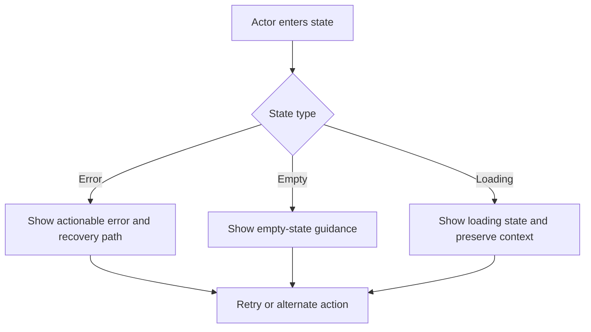

# Product Specification: Add Single Merchant

> WARNING: Figma comparison status: Completed for node 1555:53728 (2026-09-10). Reconciliation surfaced one PRD drift (two-step flow, no scan-choice buttons shown in Figma) and two silent gaps (per-URL MCC, optional Step 2 fields), all arbitrated and encoded below as `ASSUMED:`. PRD amended same day to reflect the two-step structure.
>
> Impact: Scan-choice button placement on Step 2 is not yet reflected in Figma; needs design update before build. MCC and Step 2 fields need PM confirmation they are in scope (flagged inline).
>
> Action: Confirm the three flagged items with design/PM before build sign-off; otherwise ready.

**Feature Branch**: `add-single-merchant`
**Document Name**: `add-single-merchant-spec`
**Created**: 2026-09-10
**Status**: Draft
**Input**: PRD `../prd/add-single-merchant-prd.md` v1 (2026-09-03)
**Sources**: [PRD](../prd/add-single-merchant-prd.md), [Discovery](../discovery/add-single-merchant-discovery.md), [Figma](https://www.figma.com/design/kxzxm9iEiCqzo2ewSKAoWA/Unified-Platform-2026?node-id=1555-53728&t=LFnhDf9xq6gA55XS-4)

## Brain Grounding

- `domains/atlas/second-brain/context/features/`: no feature note exists for `add-single-merchant`. Gap - no prior domain knowledge to ground against beyond the PRD and discovery.
- `domains/atlas/second-brain/hypotheses/`: no hypothesis file for this feature.
- `domains/atlas/second-brain/decisions/`: no standing decision on this flow.
- `domains/atlas/second-brain/glossary/README.md`: **Portfolio**, **Merchant**, **URL**, **Scan**, **Onboarding**, **Monitoring** are all marked `[documented-retired]` (definitions exist but flagged for review). Spec uses these terms as the PRD does; no conflicting or fresher term found.
- `domains/atlas/second-brain/context/platform.md`: confirms Merchant Monitoring functionality traces to legacy MerchantView/EverC (`mlrc-merchant`, `mlrc-monitoring`), consistent with the discovery's cited repos. No contradiction with PRD scope.
- No brain content contradicts PRD intent. Recommend `/ingest` or `/retro` after close to seed a feature note, per the README's Last Verification note.

## User Scenarios & Testing

### Figma Comparison Check

Not completed. Reconciliation deferred; warning block retained above.

## User Stories

### User Story 1 - Create merchant and scan now (Priority: P1)

A monitoring operator opens the Add New Merchant panel from a specific portfolio's merchant list, enters merchant details, and creates the merchant with an immediate scan request while remaining on the normal monitoring schedule.

**Why this priority**: Primary path migrating clients need to move off legacy MerchantView's onboarding-coupled add flow (PRD Problem Statement).

**Independent Test**: Open panel on an eligible portfolio, submit valid data via "Create merchant and scan now," verify merchant + portfolio + product assignment + monitoring activation + immediate scan request, no onboarding enrollment.

**Acceptance Criteria**:

```gherkin
Scenario: Successful create with immediate scan
  Given the active portfolio is active and has the monitoring product/service enabled
    And I have entered a valid Legal Name, a unique Client Merchant Key, and at least one valid Merchant URL with its MCC on Step 1
    And I have advanced past Step 2 (Additional Merchant Details and Principal Details), leaving its optional fields blank or filled
  When I select "Create merchant and scan now"
  Then the system creates the merchant, assigns it to the active portfolio, applies the portfolio's enabled products, and activates monitoring
    And the system requests an immediate monitoring scan
    And the merchant remains scheduled for the next monitoring cycle
    And the system does not enroll the merchant in onboarding
    And the system shows a confirmation with the merchant, portfolio, monitoring cycle, and scan choice

Scenario: Duplicate Client Merchant Key on scan-now submission
  Given the entered Client Merchant Key exists for another merchant in this customer account
  When I submit with "Create merchant and scan now"
  Then the backend rejects the request with a conflict
    And the system shows an error that the Client Merchant Key is already in use
    And no merchant, portfolio assignment, or product assignment is persisted
```

### User Story 2 - Create merchant and scan later (Priority: P1)

A monitoring operator adds a merchant to monitoring without requesting an immediate scan, leaving it to the next scheduled monitoring cycle.

**Why this priority**: Equal-weight primary action alongside scan-now; both are the only two submit paths in the panel (PRD Scope).

**Independent Test**: Open panel on an eligible portfolio, submit valid data via "Create merchant and scan later," verify merchant + portfolio + product assignment + monitoring activation with no immediate scan request.

**Acceptance Criteria**:

```gherkin
Scenario: Successful create without immediate scan
  Given the active portfolio is active and has the monitoring product/service enabled
    And I have entered a valid Legal Name, a unique Client Merchant Key, and at least one valid Merchant URL with its MCC on Step 1
    And I have advanced past Step 2 (Additional Merchant Details and Principal Details), leaving its optional fields blank or filled
  When I select "Create merchant and scan later"
  Then the system creates the merchant, assigns it to the active portfolio, applies the portfolio's enabled products, and activates monitoring
    And the system does not request an immediate scan
    And the merchant is scheduled for the next monitoring cycle
    And the system does not enroll the merchant in onboarding
    And the system shows a confirmation with the merchant, portfolio, monitoring cycle, and scan choice

Scenario: Save transaction fails on scan-later submission
  Given all entered data is valid and the portfolio is eligible
  When the merchant, portfolio, and product assignment transaction fails
  Then the system shows that the save failed and the reason
    And no merchant, portfolio assignment, or product assignment is persisted
```

### User Story 3 - View portfolio configuration and blocking (Priority: P2)

Before submitting, the operator sees the active portfolio's name, monitoring cycle, and enabled products; if the portfolio cannot accept a new merchant, creation is blocked with the existing message.

**Why this priority**: Supports the two primary actions by setting correct expectations and preventing failed submissions; not independently value-delivering without Story 1/2.

**Independent Test**: Open panel on an eligible portfolio and confirm read-only summary renders; open panel on an inactive/product-disabled portfolio and confirm the block message renders instead of the form.

**Acceptance Criteria**:

```gherkin
Scenario: Portfolio configuration shown read-only
  Given I have opened the "Add New Merchant" side panel for a portfolio
  Then the system shows the portfolio's name, enabled services/products, and monitoring cadence at the top of the panel
    And these fields are read-only and cannot be edited from the panel

Scenario: Ineligible portfolio blocks the panel
  Given the active portfolio is inactive, or the monitoring product/service is not enabled in the portfolio
  When I open the "Add New Merchant" side panel for that portfolio
  Then the system blocks merchant creation
    And shows the existing message that uploads and scans are unavailable until an admin enables at least one product in Settings
```

## Requirements

### Functional Requirements

- **FR-001**: The system MUST render the existing Add New Merchant side panel when the operator clicks Add above a specific portfolio's merchant list.
- **FR-002**: The system MUST display the active portfolio's name, monitoring cadence, and enabled products as a read-only summary at the top of the panel, before any input.
- **FR-003**: The system MUST block merchant creation and show the existing "uploads and scans are unavailable" message when the active portfolio is inactive or has no monitoring product/service enabled.
- **FR-004**: The system MUST require Legal Name, Client Merchant Key (Unique ID), and at least one Merchant URL with its MCC; DBA, MID, and up to nine additional URLs (each with its own MCC) are optional. ASSUMED: per-URL MCC per Figma node 1555:53728, not previously specified - flag for PM confirmation.
- **FR-004a**: The system MUST present Step 1 (Legal Name, Unique ID, DBA, MID, Merchant URL(s) + MCC) before Step 2, advancing via a **Next** action. ASSUMED two-step flow per Figma; ../../prd/add-single-merchant-prd.md User Journeys note.
- **FR-004b**: The system MUST present Step 2 with optional Additional Merchant Details (up to 5 locations: Name, Email, Address, Phone) and optional Principal Details (up to 5 principals: first/last name, email, phone, address, country, state/region, city, zip/postal). No field in Step 2 is required. ASSUMED in scope per Figma; not previously specified - flag for PM confirmation.
- **FR-005**: The system MUST validate required fields and URL format inline, using existing validation rules with no new rules added.
- **FR-006**: The system MUST check Client Merchant Key uniqueness within the active portfolio client-side before submission (existing behavior).
- **FR-007**: The system MUST reject a Client Merchant Key duplicate at the customer-account level server-side with `409 Conflict`, and the UI MUST surface this as an in-use error without persisting any data.
- **FR-008**: The system MUST offer exactly two submit actions on Step 2: "Create merchant and scan now" and "Create merchant and scan later," alongside a **Back** action to return to Step 1. ASSUMED placement at end of Step 2; neither action appears in current Figma (which shows **Done** only) - flag for PM/design confirmation.
- **FR-009**: On either submit action, the system MUST create the merchant, assign it to the active portfolio, apply the portfolio's enabled products, and activate monitoring in one transaction, with no onboarding enrollment.
- **FR-010**: On "Create merchant and scan now," the system MUST additionally request an immediate monitoring scan without altering the next scheduled cycle.
- **FR-011**: On "Create merchant and scan later," the system MUST NOT request an immediate scan; the merchant waits for the next scheduled monitoring cycle only.
- **FR-012**: On successful save, the system MUST show a confirmation containing the merchant, its portfolio, monitoring cycle, and the scan choice made.
- **FR-013**: On save failure, the system MUST show that the save failed and the reason, and MUST NOT persist the merchant, portfolio assignment, or product assignment.
- **FR-014**: The existing single-merchant-add API MUST remain backward-compatible (same request/response contract) while performing monitoring-only assignment (portfolio, products, monitoring activation) with no onboarding enrollment.
- **FR-015**: Only Risk Analyst and Platform Admin roles MUST be able to open the Add New Merchant panel from a portfolio's merchant list; all other roles are denied.

## Business Logic

### Logic Narrative

Opening the panel first evaluates portfolio eligibility (active + monitoring product/service enabled). Ineligible portfolios short-circuit to the block message; the form never renders. Eligible portfolios render the read-only portfolio summary captured at panel-open time, plus the empty Step 1 form. Step 1 validation (required fields, URL format including per-URL MCC, uniqueness) gates **Next** into Step 2, an entirely optional set of additional-location and principal fields. From Step 2, the operator chooses **Back** (returns to Step 1, entries preserved) or submits via scan choice. Submission (either action) attempts a single transactional save of merchant + portfolio assignment + product assignment + monitoring activation, including any Step 2 data entered. Scan choice only affects whether an immediate scan is additionally requested; it never changes the assignment or activation logic. A transaction failure at any point rolls back the entire save; partial state is never persisted.

### Decision Rules

| Rule ID | Condition / Input | Decision Logic | Outcome | Exception Handling |
|---|---|---|---|---|
| BL-001 | Portfolio is inactive or monitoring product/service not enabled | Evaluated on panel open, before form render | Block panel, show existing message | None - operator must resolve portfolio config outside this panel |
| BL-002 | Client Merchant Key duplicates another merchant in the customer account | Checked client-side against active portfolio; enforced server-side account-wide | Server returns `409 Conflict`; UI shows in-use error | No merchant/portfolio/product assignment persisted |
| BL-003 | Operator selects "scan now" vs "scan later" | Scan choice only gates the immediate-scan request | Both paths create merchant, assign portfolio/products, activate monitoring; only "scan now" adds an immediate scan request | N/A - both paths always retain the next scheduled cycle |
| BL-004 | Merchant/portfolio/product assignment transaction fails at any step | All-or-nothing transaction | No merchant, portfolio assignment, or product assignment persisted; failure reason shown | Operator retries from the same form state |
| BL-005 | Operator advances Step 1 to Step 2 via Next | Step 1 fields must pass validation first | Step 2 renders with prior Step 1 entries retained | Operator can click Back to return to Step 1 without losing entries |
| BL-006 | Step 2 fields left blank | All Step 2 fields are optional | Submission proceeds with no additional location/principal data | N/A |

### Workflow Sequencing

```mermaid
flowchart TD
  A[Operator clicks Add on portfolio merchant list] --> B{Portfolio active and monitoring enabled?}
  B -->|No| C[Block panel, show existing message]
  B -->|Yes| D[Render read-only portfolio summary + empty form]
  D --> E[Step 1: Operator enters Legal Name, Unique ID, URL(s)+MCC, optional DBA/MID]
  E --> F{Field/URL/MCC/uniqueness validation passes?}
  F -->|No| G[Show inline validation errors]
  F -->|Yes| E2[Operator clicks Next]
  E2 --> E3[Step 2: optional Additional Merchant Details + Principal Details]
  E3 --> E4{Operator clicks Back?}
  E4 -->|Yes| D
  E4 -->|No| H[Operator selects scan now or scan later]
  H --> I[Attempt transactional save: merchant + portfolio + products + monitoring activation + Step 2 data]
  I --> J{Save succeeds?}
  J -->|No| K[Show failure reason, persist nothing]
  J -->|Yes| L{Scan now selected?}
  L -->|Yes| M[Request immediate scan, keep next scheduled cycle]
  L -->|No| N[Leave to next scheduled cycle only]
  M --> O[Show confirmation: merchant, portfolio, cycle, scan choice]
  N --> O
```

### Priority, Overrides, and Conflicts

| Scenario | Default Rule | Override Rule | Final Behavior | Owner |
|---|---|---|---|---|
| Portfolio monitoring cycle/products change while panel is open | ASSUMED: submission uses the config previewed at panel-open time, no forced refresh | None defined for MVP | Merchant is assigned the previewed config; no re-fetch on submit. Losing option: refresh-and-require-review on change (named in PRD Open Questions) | Adi Geva - flip in review if refresh-on-change is required |

## Key Entities

- **Merchant**: A business entity added to ongoing monitoring; identified by Client Merchant Key (unique per customer account), carries Legal Name, optional DBA/MID, one or more Merchant URLs each with an MCC, and optional additional locations and principals.
- **Portfolio**: Operational grouping of merchants that determines monitoring cycle and enabled products; must be active and monitoring-enabled to accept a new merchant.
- **Monitoring cycle**: The portfolio-level cadence at which assigned merchants are scanned; independent of an individual merchant's immediate-scan request.
- **Principal**: An optional beneficial-owner-like contact associated with a merchant (name, contact info, address); up to 5 per merchant, all fields optional. ASSUMED to satisfy the PRD's open beneficial-owner question as an optional Step 2 field, not a required one - see PRD Open Questions.

## Business Rules

| ID | Rule | Applies To | Notes |
|---|---|---|---|
| BR-001 | A merchant created through this panel is never enrolled in onboarding | All create actions | Core differentiator from the legacy Add Merchant flow (PRD Problem Statement) |
| BR-002 | Client Merchant Key is unique per customer account, not per portfolio | Uniqueness validation | Client-side check is portfolio-scoped only; server is the account-wide source of truth |
| BR-003 | Merchant, portfolio assignment, and product assignment save as a single transaction | Both scan choices | No partial persistence on failure |

## Permissions Matrix

| Actor / Role | Can Do | Cannot Do | Notes |
|---|---|---|---|
| Risk Analyst | Open panel, view portfolio summary, create merchant (either scan choice) | Change monitoring cycle or enabled products from this panel | Matches PRD Permissions table |
| Platform Admin | Open panel, view portfolio summary, create merchant (either scan choice); change monitoring cycle/products in Portfolio Settings | N/A | Portfolio Settings changes are out of scope for this panel |
| All other roles | Nothing in this flow | Open panel or create merchant | Denied entirely |

## UX States

| State | User Sees | System Behavior | Notes |
|---|---|---|---|
| Panel open, eligible portfolio | Read-only portfolio summary (name, cycle, products) + empty Step 1 form | Renders immediately, no loading delay specified | FR-001, FR-002 |
| Panel open, ineligible portfolio | Existing "uploads and scans are unavailable" message | Form does not render | FR-003 |
| Step 1 filled, valid | Enabled **Next** action | No blocking state | FR-004a |
| Step 2, entered from Step 1 | Optional Additional Merchant Details and Principal Details fields, all blank; **Back** and scan-choice actions enabled | Step 1 entries retained if operator returns via Back | FR-004b, FR-008 |
| Submitting | ASSUMED: submit actions disabled/show a busy indicator during the save transaction to prevent double-submit | Prevents duplicate transactional saves | No explicit PRD statement; standard reused pattern for this existing panel - flip if the existing panel behaves differently |
| Success | Confirmation with merchant, portfolio, cycle, scan choice | Panel closes or resets per existing pattern | FR-012 |
| Failure | Top-level error with reason | No data persisted; ASSUMED operator remains on Step 2 | FR-013 |

## Error / Empty / Loading States



| Situation | User Message / UI | Recovery Action | Priority |
|---|---|---|---|
| Portfolio inactive or monitoring not enabled | Existing "uploads and scans are unavailable... enable at least one product in Settings" message | Operator or admin resolves portfolio config, then retries | High |
| Required field missing or invalid URL format | Inline field/row-level validation error | Correct the field and resubmit | High |
| Duplicate Client Merchant Key | "Client Merchant Key is already in use" error | Change the Unique ID and resubmit | High |
| Save transaction fails | Top-level error with failure reason | Retry submission; no partial data exists | High |
| Panel has no prior input (initial state) | Empty form fields under the read-only portfolio summary | N/A | Low |

## Analytics Events

Feature emits events; see `spec-analytics-sections.md` for the two paired sections. Measurement design itself is owned by `/analytics-plan`, run after this spec.

### Events To Instrument

| Event / Signal | Trigger | Key Properties | Purpose | Required for MVP |
|---|---|---|---|---|
| Merchant add panel opened | Operator clicks Add above merchant list | portfolio_id, account_id | Measure funnel entry | Yes |
| Merchant creation submitted | Operator clicks either create action | portfolio_id, scan_choice (now/later), account_id | Measure completion and scan-choice split | Yes |
| Merchant creation blocked | Panel opens on ineligible portfolio | portfolio_id, block_reason | Measure portfolio-block rate | Yes |
| Merchant creation validation failed | Submit with invalid/missing/duplicate data | portfolio_id, error_type | Measure validation-failure rate | Yes |
| Merchant creation save failed | Transaction fails on submit | portfolio_id, failure_reason | Measure save-failure rate (guardrail) | Yes |

Source: PRD Required Events / Signals table, unchanged at spec stage.

## Assumptions

- ASSUMED: Submission uses the portfolio configuration previewed at panel-open time; no forced refresh if monitoring cycle or products change mid-session. Losing option (refresh-and-require-review) named in PRD Open Questions - flip in review if required.
- ASSUMED: URL format validation and scheme handling are reused as-is from the existing panel; no new normalization (e.g., auto-prefixing `https://`) is added for MVP. PRD Open Questions asks about scheme normalization with no evidence found of current normalization behavior - flip if discovery confirms different existing behavior.
- ASSUMED: No configured product requires beneficial-owner data at creation, per PRD Assumptions; form fields are unchanged from the existing panel.
- ASSUMED: The existing client-side Client Merchant Key uniqueness pre-check remains scoped to the active portfolio only; no new account-wide client-side pre-check is added for MVP. Server-side `409 Conflict` remains the authoritative account-wide check. Losing option (extend client-side check account-wide) named in PRD Risks - flip in review if required.
- ASSUMED: Submit actions show a busy/disabled state during the save transaction to prevent double-submission, consistent with standard reused-panel behavior; not explicitly stated in PRD or discovery.
- ASSUMED: The panel is a two-step flow (Step 1: Legal Name/Unique ID/DBA/MID/URL+MCC; Step 2: optional Additional Merchant Details + Principal Details), per Figma node 1555:53728, superseding the PRD's original "single-form entry (no steps)" framing. PRD amended 2026-09-10 to reflect this - see PRD User Journeys and UX and Product Behavior.
- ASSUMED: "Create merchant and scan now" / "Create merchant and scan later" are placed as the final submit actions on Step 2, replacing the **Done** button shown in current Figma. Figma has not yet been updated with the scan-choice requirement; PM to confirm placement with design before build.
- ASSUMED: Each Merchant URL requires an MCC selection (Step 1), not previously specified in the PRD prior to this Figma comparison.
- ASSUMED: Step 2's optional Principal Details fields satisfy the PRD's open "beneficial-owner data" question as an optional (not required) input, so PRD Assumption "no product requires beneficial-owner data at creation" still holds.

## Out Of Scope

- Bulk merchant upload, editing, removal, or migration.
- Onboarding, Quick Insights, Web ID, or on-demand rescreening flows.
- New API endpoints or API contract changes beyond preserving existing backward compatibility.
- Selecting or changing the merchant's portfolio, or overriding products per merchant, in the side panel.
- Changing the monitoring cycle, or creating/activating/configuring portfolios, in the side panel.

## Figma Alignment

| Requirement | Figma Status | Notes |
|---|---|---|
| Step 1 fields (Legal Name, Unique ID, DBA, MID, URL) | Aligned | Matches PRD/spec |
| Per-URL MCC selection | Gap (Figma has it, PRD/spec did not) | Added to spec as ASSUMED; PM to confirm scope |
| Read-only portfolio summary placement | Aligned | "Portfolio name · Monitoring Cadence" + product badges, top of panel |
| Two-step flow (Step 1 -> Next -> Step 2 -> Back/submit) | Conflict (PRD said single-form, no steps) | PRD Drift - amended PRD 2026-09-10 per PM decision |
| Step 2 optional fields (Additional Merchant Details, Principal Details) | Gap (Figma has it, PRD/spec did not) | Added to spec as ASSUMED; PM to confirm scope |
| "Create merchant and scan now" / "scan later" actions | Gap (Figma shows **Done** only, no scan choice) | Kept as PRD intent per PM decision; not yet in Figma - flag for design |

## Open Questions

| Question | Owner | Needed Before | Priority |
|---|---|---|---|
| Should submission refresh and require review if portfolio monitoring cycle/products change while the panel is open, rather than using the previewed config (current ASSUMED default)? | Adi Geva | Build | Medium |
| Should the client-side Client Merchant Key pre-check be extended to account-wide (current ASSUMED default: portfolio-scoped only, server enforces account-wide)? | Adi Geva | Build | Medium |
| Do any configured products require beneficial-owner data at creation (current ASSUMED default: no)? | Adi Geva | Build | Medium |

## Success Criteria

### Measurable Outcomes

- **SC-001**: Operators on an eligible portfolio can complete merchant creation (either scan choice) without any onboarding enrollment occurring.
- **SC-002**: 100% of duplicate Client Merchant Key submissions are rejected with the in-use error and result in zero persisted records.
- **SC-003**: 100% of failed save transactions result in zero partial persistence (no orphaned merchant, portfolio, or product assignment records).
- **SC-004**: Save-failure rate stays within the guardrail defined in the PRD (target TBD pending 30-day post-launch baseline).

## Analytics And Measurement Requirements

Deferred to `/analytics-plan`. Events listed above are the MVP-required set carried forward unchanged from the PRD; metric targets, baselines, and reporting cadence are defined in the analytics plan, not here.

## Approval Readiness

- Three items remain TBD pending PM decision at or before build: portfolio-config-refresh behavior, account-wide uniqueness pre-check, beneficial-owner data requirement (now read as satisfied by optional Step 2 Principal Details, pending confirmation). Each has an ASSUMED default encoded above.
- Figma comparison completed for node 1555:53728 (2026-09-10). One PRD drift resolved by PM decision (two-step flow); scan-choice button placement still needs a design update to match. MCC and Step 2 fields need PM/design confirmation they're in scope.
- Analytics events are listed; targets/baselines deferred to `/analytics-plan` (expected, not a gap).
- No brain contradiction found; no feature-level brain note existed prior to this spec (gap noted in Brain Grounding).
