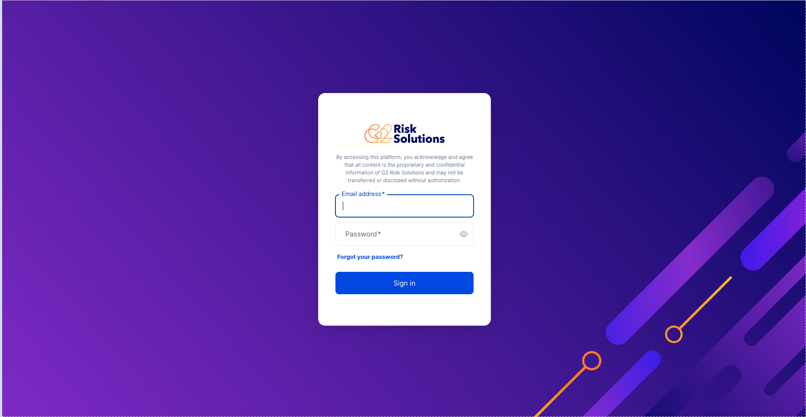
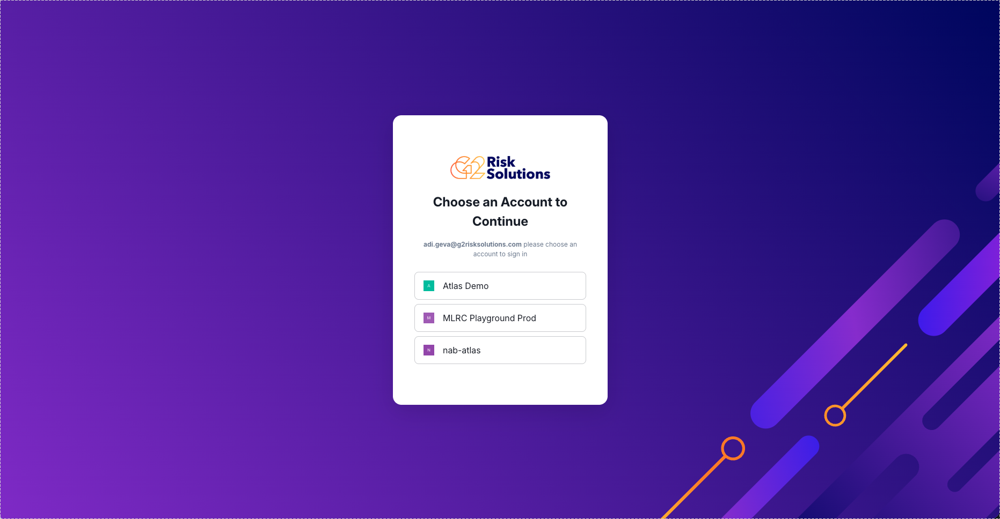
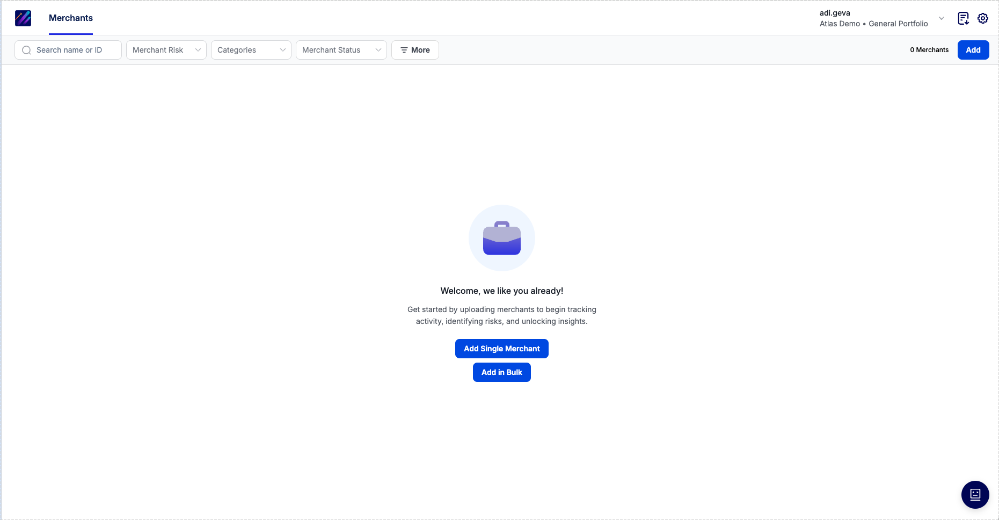

# How to Log In to Atlas

Follow these steps to log in to the Atlas Demo account.

## Step 1: Open Atlas

Go to [https://app.g2rs.ai/](https://app.g2rs.ai/).

## Step 2: Sign in

Enter your email address and password, then click **Sign in**.

If you do not remember your password, click **Forgot your password?**

## Step 3: Choose Atlas Demo

On the **Choose an Account to Continue** page, click **Atlas Demo**.

## Step 4: Confirm you are in Atlas Demo

The **Merchants** page opens. The top-right corner shows **Atlas Demo • General Portfolio**.

## Need help?

If you cannot sign in, or **Atlas Demo** is not in the account list, contact:

- Adi Geva: [adi.geva@g2risksolutions.com](mailto:adi.geva@g2risksolutions.com)
- Alla Avgustinov: [alla.avgustinov@g2risksolutions.com](mailto:alla.avgustinov@g2risksolutions.com)
