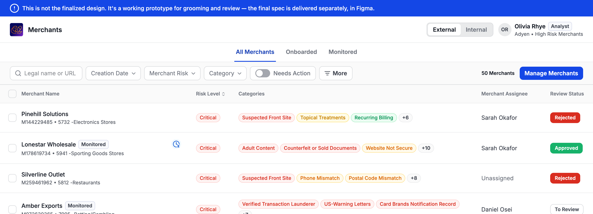
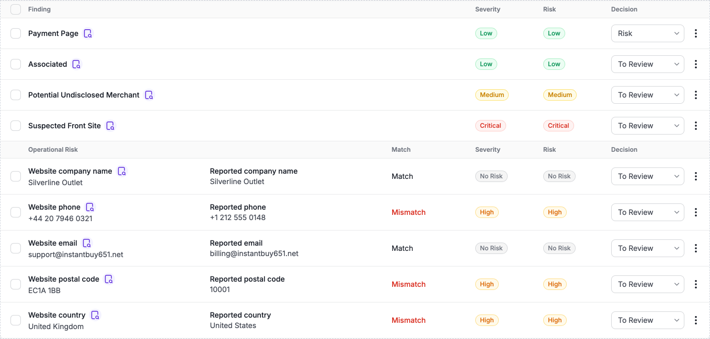
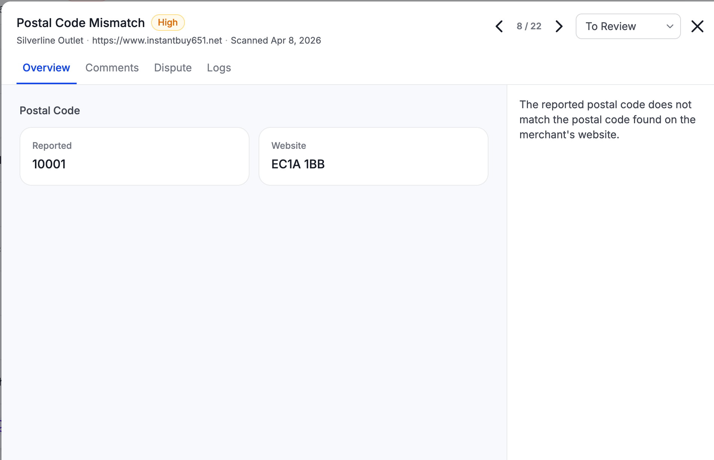

# Verify Merchant Details Against Website, Mini PRD

**TL;DR:**
Compare the merchant details a client submits to G2 with the merchant's website, and raise each discrepancy in name, phone, email, street address, postal code, or country as a risk finding. Merchant detail changes made by a user are recorded in the merchant's activity log.

 

## Definitions

- **Submitted data**: the merchant's legal name, phone, email, street address, postal code, and country that the client submits to G2 when adding the merchant to Atlas, for Onboarding or Monitoring. Street address is the street, street number, and city.
- **Extracted data**: the phone and email Core finds by crawling the merchant's website, and street address, postal code, and country once Core extracts them.
- **Operational Risk service**: a G2 service, separate from the MCC, CC, and graph services, that includes merchant identity verification. A client turns it on or off per portfolio.
- **Reviewer**: the risk analyst or risk manager who decides whether a mismatch finding is correct.

 

## Problem and Goal

When a client adds a merchant to Atlas for Onboarding or Monitoring, it submits the merchant's legal name, phone, email, and address to G2. A discrepancy between these details and the merchant's website is a risk indicator, for example a merchant submitted as operating in the U.S. whose website lists a sanctioned country.

Goal: For each merchant a client adds to Onboarding or Monitoring in a portfolio with the Operational Risk service on, Atlas compares the submitted legal name, phone, email, street address, postal code, and country with the merchant's website, and raises each discrepancy as a risk finding.

**Why we need it:** A discrepancy between the submitted details and the merchant's website indicates possible misrepresentation that the client's risk team must assess.

**Value for the client:** Risk analysts see each discrepancy as a finding on the merchant, with the submitted and website values side by side, and act on it as part of their review.

**Why now:** NAB requires this check. Clients migrating from MerchantView to Atlas rely on the phone and email checks MerchantView provides today.

 

## Prototype

[Open prototype](https://claude.ai/artifact/5XpL8CwLa7HfrdgAkXrpfR)

The design is not finalized. It requires approval from Dana Friedman, Senior Product Designer.

**1. Merchants list, identity mismatches shown as categories**

**2. Merchant onboarding scan, Operational Risk section with one row per identity field**

**3. Postal code mismatch, submitted and website values**

The prototype's demo controls, such as Simulate failure, exist only in the prototype.

 

## Feature Behavior

### Prerequisites

- The client submitted the merchant's website, and the website is online when scanned.
- A check runs only for a field that has a value on the merchant record in Atlas. Merchant name and website are the only mandatory fields, so each of legal name, phone, email, street address, postal code, and country is checked only when the client entered it.
- When the client submits no merchant details besides merchant name and website, identity verification does not run.

### Requirements

1. Core crawls the merchant's website, extracts phone and email, and searches the page content for the submitted legal name. Core's Company Name and Address Mismatch service extracts the website's addresses, parses each into street, street number, city, postal code, and country, and compares them with the submitted address. Separate postal code and country results are new work in Core.
2. For phone, email, street address, postal code, and country, Core compares the submitted value to the website value. For phone and email, Core uses the first value it finds on the website. For company name, Core checks whether the legal name appears in the page content.
3. Core returns one result per field, from the result types in the Core results table. Atlas shows a row only for Matched and Mismatch results.
4. In the website's findings table on the merchant's scan, the identity findings appear in a separate section titled Operational Risk, below the website's other findings, in the same layout as the MCC section. MCC findings stay in the MCC section, since MCC is a separate service. When a scan has no identity finding, the Operational Risk section does not appear.
5. Each identity finding is one row in that section, showing Website and the field name with the extracted value, for example Website phone, then Reported and the field name with the submitted value, for example Reported phone, then the result under Match, then severity, risk, and decision. The Website value comes from Core. The Reported value comes from the merchant record in Atlas at the time of the scan, never from Core.
6. Opening a finding's evidence shows the submitted value next to the extracted value.
7. Each mismatch finding also appears in the merchant's categories on the Merchants list.
8. When any Atlas user changes the merchant's details, the merchant's activity log records the user, the date and time, and each changed field with its previous and new value.
9. Identity verification uses the new values from the merchant's next scan. A change does not start a scan.
10. Existing identity findings keep the Reported value and result from the scan that produced them.

**Comparison by field**

| Field | Matches when |
|---|---|
| Company name | The normalized legal name appears anywhere in the website's page source, including inside a longer word. |
| Phone | The two numbers are equal after normalization. An invalid number on either side is a mismatch. |
| Email | Generic provider such as gmail: the full address is equal. Company domain: the domain is equal, so `sales@acme.com` matches `support@acme.com`. |
| Street address | The street, street number, and city are equal after normalization. |
| Postal code | The two postal codes are equal after normalization. |
| Country | The two countries are equal after normalization. |

**Core results**

The mismatch logic runs in Core, after the website crawl. Atlas receives the result and does not compare values itself.

| Field | Core result | Core ID | Core finding type | In Atlas |
|---|---|---|---|---|
| Phone | Phone Matched | 364 | Website Section | Row, Match |
| | Phone Mismatch | 357 | Signals | Row, Mismatch |
| | Missing Phone | 360 | Insights | No row |
| Email | Email Matched | 363 | Website Section | Row, Match |
| | Email Mismatch | 356 | Signals | Row, Mismatch |
| | Missing Email | 359 | Insights | No row |
| Company name | Company Name Matched | 365 | Website Section | Row, Match |
| | Company Name Mismatch | 358 | Signals | Row, Mismatch |
| | Missing Company Name | 361 | Insights | No row |

Street address uses Core's Address Match 366 and Address Mismatch 355 results. Postal code and country each have a Matched and a Mismatch result. Each Matched result shows a row with Match, and each Mismatch result shows a row with Mismatch. A Missing result for street address, postal code, or country shows no row.

Throughout this document, an identity finding is a Matched or Mismatch result that Atlas shows as a row.

- Missing means the client submitted a value and the website shows none.
- Street address, postal code, and country are separate results, so a merchant can match on one and mismatch on another.

**Severity and risk**
- A Mismatch finding has High severity.
- Its risk is set by the client's Risk Matrix, and the reviewer's Decision can change it, as for any other finding.
- It raises the merchant's overall risk, as any other finding does.
- A Match finding has No risk severity and No risk, so it adds no risk to the merchant.
- A Missing result adds no risk to the merchant, since it is not a mismatch.
- This changes MerchantView, which sets every identity finding to No risk.

**Errors**
1. If the website is offline, Core produces no identity finding for that scan.
2. If the website is a parked page, redirects, or is in a language Core does not support, Atlas shows no company name row.

**Permissions**
- Identity verification runs for each merchant that meets the Prerequisites in a portfolio with the Operational Risk service on.
- A merchant in a portfolio with the Operational Risk service off gets no identity findings.
- Turning the Operational Risk service on or off per portfolio is defined in the Operational Risk PRD. This feature has no switch of its own.

**Out of scope**
- Fuzzy or similarity matching for any field.
- Changes to the existing company name, phone, and email matching rules.

 

## Acceptance Criteria

**Scenario: Company name matches or mismatches**
- Given a merchant in a portfolio with the Operational Risk service on
- And the merchant has a submitted legal name
- When the scan completes
- Then the finding is Match if the normalized legal name appears in the website's page source
- And the finding is Mismatch if it does not, unless Core returns Missing Company Name, which shows no row

**Scenario: Phone and email results**
- Given a merchant scan of an online website
- When the scan completes
- Then phone is Match if the submitted and extracted numbers are equal after normalization, and Mismatch if they differ
- And email is Match on the full address for a generic provider, and on the domain alone for a company domain
- And a Missing result shows no row

**Scenario: Street address, postal code, and country are evaluated independently**
- Given a portfolio with the Operational Risk service on
- And a merchant in it whose submitted country and postal code match the website and whose submitted street number differs from it
- When the scan completes
- Then Core produces a separate finding for street address, postal code, and country
- And only the street address finding is a mismatch

**Scenario: Mismatch raises the merchant's risk**
- Given a merchant scan that produces a mismatch on any field
- When the risk analyst opens the merchant
- Then the finding shows High severity and the risk the client's Risk Matrix sets for it
- And the merchant's overall risk includes it
- And the mismatch appears in the merchant's categories on the Merchants list
- And a Match finding on the same scan shows No risk severity and No risk, and does not appear in the categories

**Scenario: No identity finding is produced**
- Given the merchant's website is offline, or Core found the website on its own
- When the scan completes
- Then no identity finding is produced for that website
- And the website's findings table shows no Operational Risk section

**Scenario: Identity findings appear in the Operational Risk section**
- Given a merchant scan that produces identity findings
- When the risk analyst opens the merchant's scan
- Then the website's findings table shows a section titled Operational Risk below the website's other findings
- And the section shows one row per identity finding, with the website value, the reported value, the Match result, severity, risk, and decision
- And no identity finding appears among the website's other findings

**Scenario: Check runs only for fields on the merchant record**
- Given a portfolio with the Operational Risk service on
- And a merchant record with merchant name, website, and phone, and no legal name, email, street address, postal code, or country
- When the scan completes
- Then the Operational Risk section shows a phone row only

**Scenario: Merchant with only mandatory fields**
- Given a portfolio with the Operational Risk service on
- And a merchant record with merchant name and website only
- When the scan completes
- Then no identity verification runs
- And the website's findings table shows no Operational Risk section

**Scenario: User changes merchant details**
- Given a merchant whose phone on the merchant record is +1 212 555 0100
- When an Atlas user changes the phone to +1 212 555 0199
- Then the merchant's activity log shows that Atlas user, the date and time, the field Phone, the previous value +1 212 555 0100, and the new value +1 212 555 0199
- And the existing phone finding keeps the Reported phone +1 212 555 0100 and its result
- And the merchant's next scan compares the website phone with +1 212 555 0199

**Scenario: Operational Risk service off**
- Given a merchant in a portfolio with the Operational Risk service off
- When the merchant's scan completes
- Then no identity finding is produced
- And the findings table shows no Operational Risk section

 

## Data

**Baseline**
- Phone and email mismatch rate in MerchantView today: TBD. The figure needs Core scan results through Looker, which is not connected.

**Success measure**
- Country mismatches per client after release, the risk case behind this feature.
- Confirmed mismatch rate: of mismatch findings a reviewer decided on, the share confirmed correct, reported with the number reviewed.

**Recorded data**
- Each finding stores the field, its result, its severity, and its risk.
- Analytics records whether the client and the website supplied a value, never the value itself.

 

## Open Questions / Assumptions

- Ask Gal which data points Core will provide to Atlas, including postal code and country. Today Core extracts phone, email, address, and company name, and sends only the comparison results as findings.
- Confirm with Core that each result sends the website value as a field Atlas can show. Today Core sends it only inside the finding's evidence text.
- Confirm with Atlas engineering that Core's identity results are turned on in Atlas's category settings for portfolios with the Operational Risk service on. Atlas marks a result inactive otherwise.
- Ask Core why each field is extracted and how each is normalized before comparison, including what counts as equal for street address, postal code, and country, such as "US" and "United States", and which value is used when the website shows several.
- Confirm with Core the current implementation and plans for company name, street address, postal code, and country verification: whether they run for every portfolio with the Operational Risk service on, since Core gates company name and address behind per-client switches today. See K9-225, K9-166, K9-269.
- Confirm with Core whether Address Match 366 and Address Mismatch 355 cover street, street number, and city only, and which Core finding type each one has. The Company Name and Address Mismatch service compares the full address today, so separating postal code and country is a change to Core.
- Ask Core to add a Missing street address result for a submitted address the website does not show, and to provide its ID.
- Ask Core to add Matched, Mismatch, and Missing results for postal code and for country, and to provide each result's ID and Core finding type.
- Confirm with Core whether its fixed list of generic email providers stays unchanged in this release.
- Confirm with Core that Company Name Matched and Company Name Mismatch carry the company name found on the website. In the Core code inspected, the company name check searches the page for the submitted legal name and stores no website name.
- Confirm with Core when it returns Missing Company Name rather than Company Name Mismatch.
- Decide whether the doing-business-as name, referred to as DBA, or aliases feed name matching. Only the legal name does today.
- Decide whether turning on the Operational Risk service re-evaluates past scans or applies only to new scans.
- Decide whether a mismatch stays in the Merchants list categories after the reviewer's Decision lowers its risk.
- Confirm whether the reviewer's Decision records whether a mismatch was correct. If not, the confirmed mismatch rate uses a manual sample.

 

## Evidence

- Core behavior: [reverse-engineering](../current-state/verify-merchant-details-against-website-reverse-engineering.md), inspected 2026-10-15, rechecked 2026-10-18, and extended 2026-10-20 with what Atlas and MerchantView receive from Core. Core result types: `FindingSubType.java:561-575` in the `core` repository. Tests were not run.
- Jira: K9-225, K9-166, K9-269, MERV-43351, MERV-39442.
- Confluence: [Company Name and Address Mismatch](https://g2rs.atlassian.net/wiki/spaces/CATS/pages/4031382453/Company+Name+and+Address+Mismatch), Core's address extraction and match service (K9, page 4031382453); Address & Company M/MM release notes (PROD, page 4031909534); Risk and Actioning for Findings, URLs, Merchants - PRD (UP, page 4032594064).
- No brain page covers this feature.
