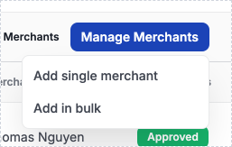
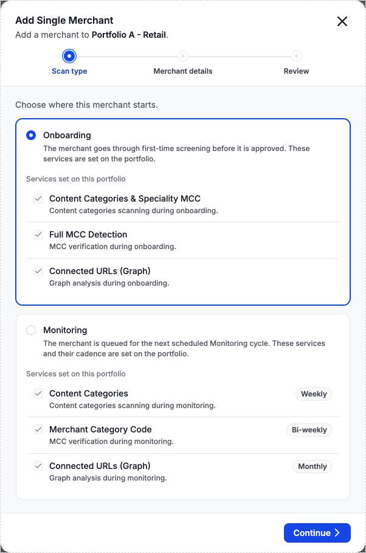
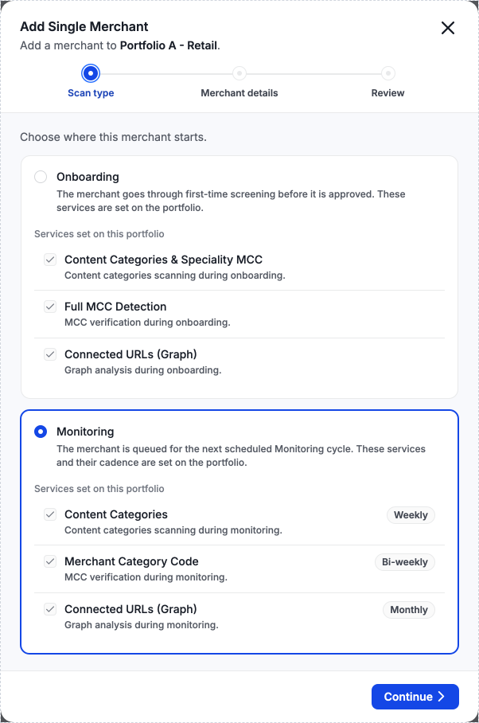
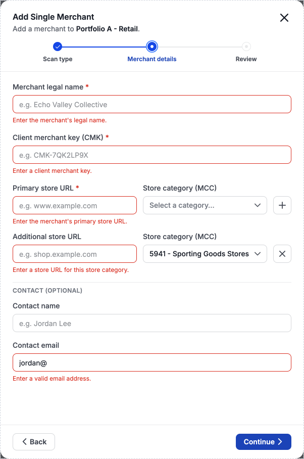
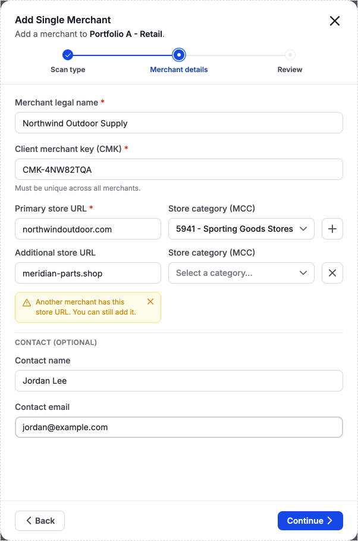
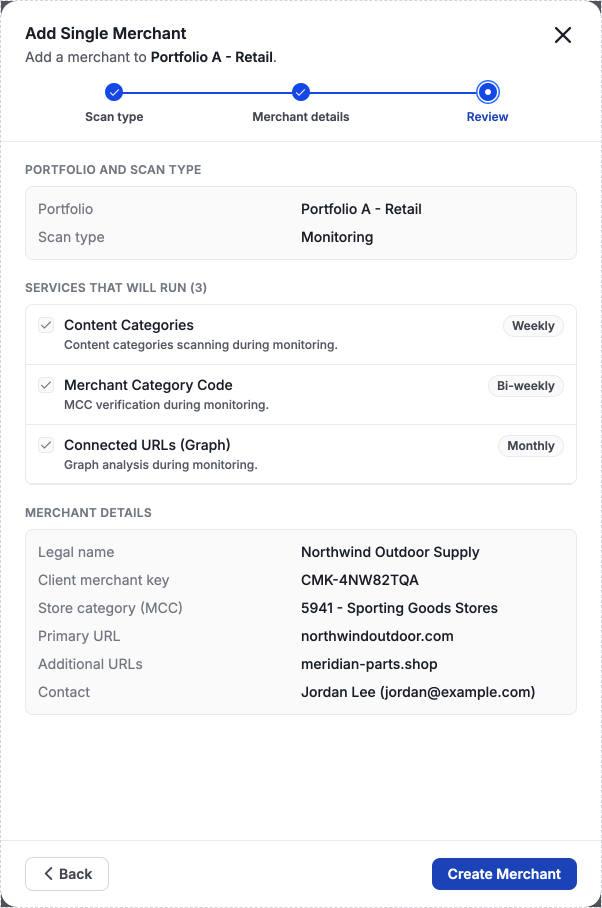
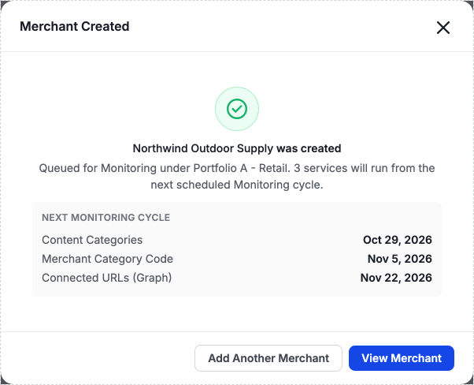

# Wizard for Add Merchant to Onboarding or Monitoring - MVP - Mini PRD

**TL;DR:**
Add Single Merchant opens a wizard where the user enrolls a new merchant in Onboarding or in Monitoring, under the portfolio they are working in, with the services that portfolio has enabled.

 

## Definitions

- **Current portfolio**: the portfolio whose merchant list the user is on when they select Manage Merchants, then Add Single Merchant. The new merchant is assigned to this portfolio.
- **Onboarding**: the first screening a merchant goes through before it is approved to process.
- **Monitoring**: the recurring screening of a merchant, where each service runs on the cadence set for that service on the portfolio.
- **Service**: one of the scan types a portfolio runs against its merchants. The services for Onboarding and for Monitoring are configured at the portfolio level, and each configured service is enabled or disabled. The Onboarding services a portfolio can enable are Content Categories & Speciality MCC, Full MCC Detection, and Connected URLs (Graph). The Monitoring services a portfolio can enable are Content Categories, Merchant Category Code, and Connected URLs (Graph).
- **Client merchant key**: the identifier the client assigns to the merchant.

 

## Problem and Goal

Add Single Merchant creates a merchant in Monitoring only. A user has no way to add a single merchant to Onboarding from the UI.

Goal: A user can add a single merchant to either Onboarding or Monitoring from the UI, in one wizard, and screening runs with the current portfolio's enabled services.

**Why we need it:** Onboarding and Monitoring are separate products, and a client can have one without the other.

**Value for the client:** The client chooses whether each new merchant goes to Onboarding or to Monitoring, instead of Monitoring only, and the merchant runs the services set on the portfolio.

 

## Prototype

[Open prototype](https://claude.ai/artifact/6s3FhvardoNFsE3E1j4PEt)

Screens from the prototype, in wizard order.

**1. Manage Merchants menu**

**2. Scan type step, Onboarding selected**

**3. Scan type step, Monitoring selected**

**4. Merchant details step, validation errors, including a store category with no store URL**

**5. Merchant details step, completed, with an additional store URL that another merchant in the portfolio has**

**6. Review step**

**7. Confirmation**

 

## Feature Behavior

The prototype is based on the Add Single Merchant wizard in the [g2rs-design-system repo, `prototypes/risk-decision-prototype`](https://github.com/evercompliant/g2rs-design-system/tree/master/prototypes/risk-decision-prototype). This MVP changes that prototype in three places: there is no Portfolio step, the user selects one scan type instead of one or both, and Onboarding services are read-only.

**Assumption:** Onboarding screening starts on creation, while a Monitoring merchant waits for the next scheduled cycle, carried over from the Monitoring-only Add Single Merchant mini PRD.

### Prerequisites

- The current portfolio has Active status.

### Requirements

1. User selects Manage Merchants, then Add Single Merchant. The same menu also includes Add in Bulk, which opens a separate bulk upload flow. The wizard supports single merchant creation only, not bulk uploads.
2. The wizard opens on the Scan type step. The step names the current portfolio.
3. User selects Onboarding or Monitoring. Only one can be selected.
4. The step lists the services the current portfolio has enabled for the selected scan type. The list is read-only.
5. User selects Continue.
6. On the Merchant details step, the user enters merchant legal name, client merchant key, and primary store URL. A store category field sits next to each store URL field. Store category is optional for every store URL. The step also keeps every other merchant field the current Add Single Merchant form has.
   - Selecting + next to the primary store URL adds a row for an additional store URL and its store category, up to 5 store URLs per merchant. The + control is disabled at 5.
   - Additional store URL rows are optional. A row with no store URL and no store category does not block Continue. A row with a store category requires a store URL. The same store URL cannot be entered twice for one merchant. Two store URLs match when they are the same after ignoring letter case, "http://" or "https://", a leading "www.", and a trailing "/". The error shows on the later row.
   - A store URL that matches a store URL of another merchant in the current portfolio, by the same match rule, is allowed. A notice under that URL reads "Another merchant has this store URL. You can still add it." The notice shows as soon as the entered store URL is valid and matches. It does not block Continue, and the user can dismiss it. A dismissed notice does not show again for that store URL while the wizard is open. A row that shows an error shows the error only, without the notice. Review does not show the notice.
   - Each additional row can be removed. The primary store URL row cannot be removed. Removing a row when 5 are shown enables + again.
7. User optionally enters a contact name and contact email, then selects Continue.
8. On the Review step, the user sees the portfolio, the scan type, its services, and the merchant details: legal name, client merchant key, primary store URL, each additional store URL that is entered, the store category of each store URL when selected, and contact name and contact email when entered. To change the scan type or merchant details, the user selects Back.
9. User selects Create Merchant.
10. The merchant is created under the current portfolio and enrolled in the selected scan type.
11. A confirmation screen names the portfolio, the scan type, and the number of services that will run. For Monitoring, it also lists each Monitoring service that will run with the date of its next scheduled cycle, derived from the cadence set for that service on the portfolio.
12. From the confirmation screen, the user selects Add another merchant to restart the wizard, or View merchant to open the new merchant record.

**Onboarding vs. Monitoring**
- Onboarding: the merchant is created with status To Review, and the Onboarding services enabled for the current portfolio run on it. The user cannot add or remove services.
- Monitoring: the merchant is created with status To Review and queued for Monitoring. Each Monitoring service enabled for the current portfolio picks it up on that service's next scheduled cycle, on that service's cadence. It is never enrolled in Onboarding. The user cannot add or remove services.

**Navigation**
- Steps run in a fixed order: Scan type, Merchant details, Review.
- Back is available on every step except Scan type. Back keeps all entered data: the selected scan type, the merchant details, additional store URL rows, store categories, and dismissed notices.
- When the user returns to the Scan type step, it shows the scan types offered and the services enabled for the current portfolio at that moment. If the selected scan type is no longer offered, the selection is cleared.
- Continue on Scan type is disabled until a scan type is selected.
- Continue on Merchant details validates the fields and stays on the step if any field is invalid.
- Closing the wizard before Create Merchant discards all entered data.

**Empty state**
- If the current portfolio has no enabled services for a scan type, that scan type is not offered.
- If the current portfolio has no enabled services for either scan type, the Scan type step shows a blocked message instead of the options, and Continue is disabled. The message states whether services are not configured or are all disabled, and directs the user to the portfolio settings.

**Errors**
1. A current portfolio with Inactive status blocks creation and shows the existing "enable a product in Settings" message.
2. A blank merchant legal name shows "Enter the merchant's legal name." and blocks Continue.
3. A blank client merchant key shows "Enter a client merchant key." and blocks Continue.
4. A client merchant key that matches an existing merchant's key shows "This client merchant key is already in use. Enter a different key." and blocks Continue.
5. A blank primary store URL shows "Enter the merchant's primary store URL." and blocks Continue.
6. A primary or additional store URL that is not a valid URL shows "Enter a valid URL, e.g. example.com." and blocks Continue.
7. An additional row with a store category and a blank store URL shows "Enter a store URL for this store category." and blocks Continue.
8. A store URL that matches another store URL entered for the same merchant shows "This store URL is already entered for this merchant." and blocks Continue.
9. A contact email that is entered but is not a valid email shows "Enter a valid email address." and blocks Continue.
10. A change to the current portfolio's service configuration while the user is on Review shows a "Portfolio configuration changed" banner and refreshes the services list. Create Merchant stays disabled until the user acknowledges the change.
11. A failed creation shows a "Merchant creation failed" banner, keeps all entered data, and lets the user retry. Nothing is saved on failure.

**Permissions**
- Risk Analyst, Risk Manager, and Org Admin can open the wizard and create a merchant. All other roles cannot open it.

 

## Acceptance Criteria

**Scenario: Add a merchant to Onboarding**
- Given the user is on the merchant list of an Active portfolio with enabled Onboarding services
- And the user has the Risk Analyst, Risk Manager, or Org Admin role
- When the user opens Add Single Merchant, selects Onboarding, enters valid merchant details, and selects Create Merchant
- Then the merchant is created under that portfolio with status To Review
- And the Onboarding services that run on it are exactly the services enabled for Onboarding on that portfolio
- And the confirmation screen names the portfolio, Onboarding, and the number of services

**Scenario: Add a merchant to Monitoring**
- Given the user is on the merchant list of an Active portfolio with enabled Monitoring services
- When the user selects Monitoring, enters valid merchant details, and selects Create Merchant
- Then the merchant is created under that portfolio with status To Review
- And the merchant is queued for the next scheduled cycle of each Monitoring service enabled for the portfolio, on that service's cadence
- And the merchant has no Onboarding enrollment
- And the confirmation screen lists each Monitoring service with the date of its next scheduled cycle, derived from the cadence set for that service on the portfolio

**Scenario: Back keeps entered data**
- Given the user is on the Review step with merchant details entered
- When the user selects Back
- Then the Merchant details step shows every value the user entered, including additional store URL rows and store categories

**Scenario: Services change before the user returns to Scan type**
- Given the user is on the Merchant details step
- And the current portfolio's enabled services change
- When the user selects Back
- Then the Scan type step lists the services the portfolio has enabled at that moment
- And if the selected scan type has no enabled services left, it is not offered, nothing is selected, and Continue is disabled

**Scenario: No portfolio choice**
- Given the user opened Add Single Merchant from a portfolio's merchant list
- When the wizard opens
- Then the wizard has no Portfolio step and no control to change the portfolio
- And the Scan type step names that portfolio

**Scenario: One scan type only, services read-only**
- Given the user is on the Scan type step and the portfolio has enabled services for both scan types
- When the user selects Onboarding and then selects Monitoring
- Then only Monitoring is selected
- And the services listed for the selected scan type cannot be checked or unchecked

**Scenario: Scan type without enabled services is not offered**
- Given the current portfolio has enabled Monitoring services and no enabled Onboarding services
- When the user opens the Scan type step
- Then only Monitoring is offered

**Scenario: Portfolio with no enabled services blocks the wizard**
- Given the current portfolio has no enabled services for either scan type
- When the user opens the Scan type step
- Then a blocked message is shown instead of scan type options, and Continue is disabled
- And the message states whether the portfolio's services are not configured or are all disabled, and directs the user to the portfolio settings

**Scenario: Invalid merchant details block progress**
- Given the user is on the Merchant details step
- When the user selects Continue with a required field blank, an invalid URL, a store category without a store URL, a store URL entered twice, an invalid contact email, or a client merchant key that matches an existing merchant's key
- Then each invalid field shows its error message and the wizard stays on Merchant details

**Scenario: Store URL limit**
- Given the user is on the Merchant details step
- When the user selects + next to the primary store URL four times
- Then 5 store URL rows are shown, each with a store category field next to it, and + is disabled
- And when the user removes one additional row, 4 rows are shown and + is enabled

**Scenario: Empty additional rows do not block Continue**
- Given the user is on the Merchant details step with valid required fields and one or more additional rows with no store URL and no store category
- When the user selects Continue
- Then the wizard moves to Review

**Scenario: Store URL used by another merchant**
- Given the user is on the Merchant details step
- When the user types a valid store URL that matches a store URL of another merchant in the current portfolio
- Then the notice "Another merchant has this store URL. You can still add it." shows under that URL
- And the user can dismiss the notice, and can select Continue with or without dismissing it

**Scenario: Portfolio configuration changes during Review**
- Given the user is on the Review step
- And the current portfolio's service configuration changes
- When the Review step updates
- Then the "Portfolio configuration changed" banner is shown, the services list shows the new configuration, and Create Merchant is disabled until the user acknowledges it

**Scenario: Creation fails**
- Given the user selects Create Merchant on Review
- When creation fails
- Then the "Merchant creation failed" banner is shown, no merchant is saved, entered data remains, and the user can retry

**Scenario: Restricted role**
- Given the user does not have the Risk Analyst, Risk Manager, or Org Admin role
- When the user attempts to open Add Single Merchant
- Then the wizard does not open

 

## Data

**Baseline**
- Completion today: 23 of 59 opens of the Monitoring-only Add Single Merchant panel ended in a created merchant, 39%, from 10 users. Source: Mixpanel, Unified Platform Production, `add_merchant_single_open` and `add_merchant_single_confirmed`, 2026-07-14 to 2026-10-12. This measures the current panel, not the wizard. Whether these users include internal or test accounts is unknown.
- Onboarding adoption: no baseline. A single merchant cannot be added to Onboarding from the UI today.
- Drop-off by step: no baseline. The current panel has no Scan type or Review step. In the same period, 29 opens ended in `add_merchant_single_exit`. The remaining 7 opens have no exit or create event.
- Errors: TBD. Mixpanel has no event for validation or creation errors.

**Success measure**
- Completion rate: wizards that end in a created merchant, divided by wizards opened.
- Onboarding adoption: the share of merchants created through the wizard that are enrolled in Onboarding.
- Drop-off by step: the share of opened wizards closed on each step: Scan type, Merchant details, Review.
- Errors: the number of times each error in the Errors list is shown, per opened wizard.

Measuring these requires events that record the step on which the wizard closes, the selected scan type, and each error shown.

**Recorded data**
- The new merchant record: merchant legal name, client merchant key, primary store URL, additional store URLs when entered, the store category of each store URL when selected, contact name and contact email when entered, portfolio, scan type, and status.

 

## Open Questions / Assumptions

- Add a Why now line to the Goal: no trigger, such as a client requirement or deadline, is known.

